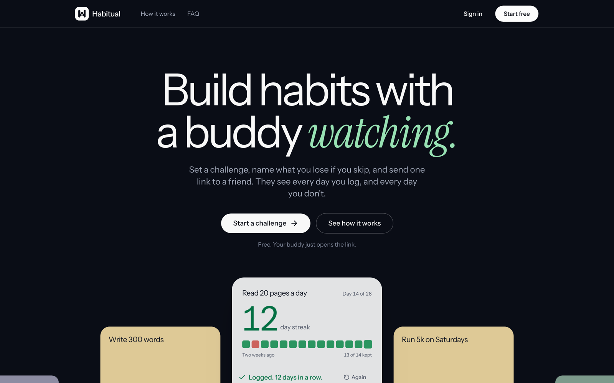
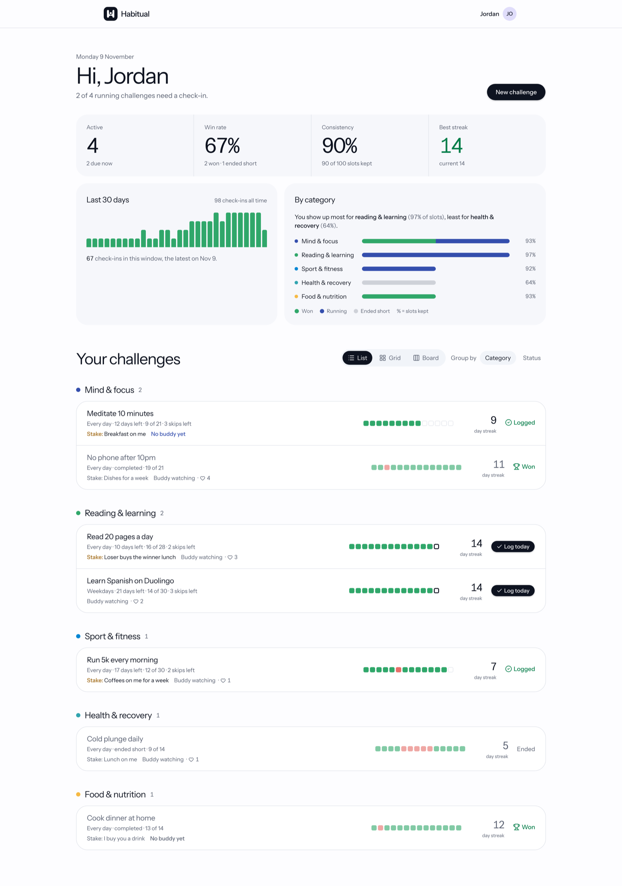
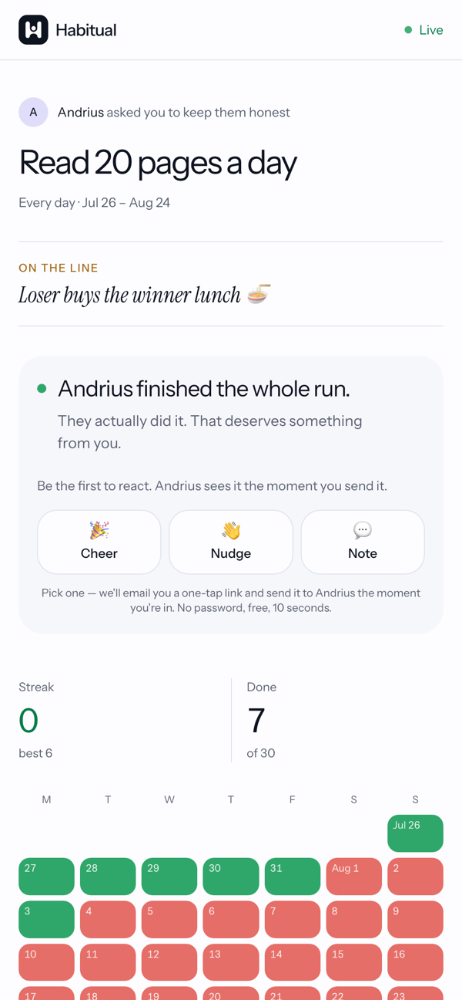
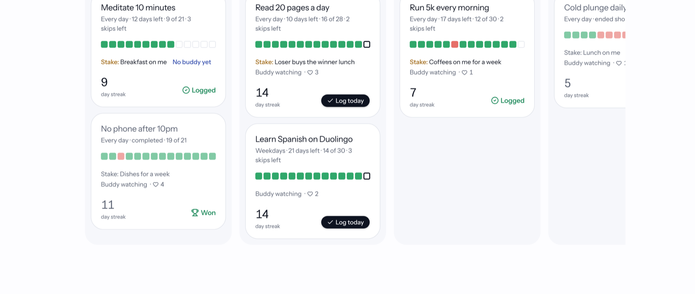
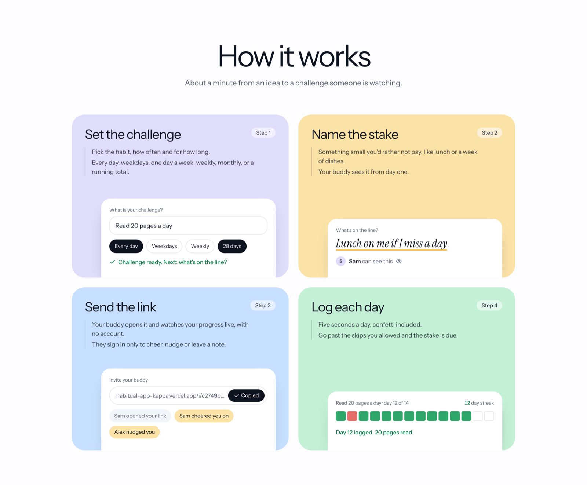
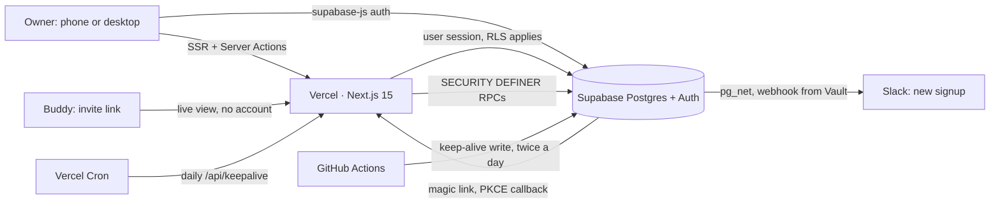

<p align="center">
  
</p>

<p align="center">
  <a href="https://habitual-app-kappa.vercel.app"><b>Live app →</b></a>
  ·
  <a href="#features">Features</a>
  ·
  <a href="#how-its-built">How it's built</a>
  ·
  <a href="#run-it-yourself">Run it yourself</a>
</p>

<p align="center">
  
  
  
  
  
  
  <a href="https://github.com/andriuskleinas/habitual/actions/workflows/ci.yml"></a>
  
</p>

# Habitual 🔥

**A mobile-first habit tracker where you put something on the line and invite a friend to watch.**
Set a challenge, name a stake, send a link. Your buddy doesn't need an account to follow along, and
can cheer, nudge or call you out as you go.

## Why

Solo habit trackers are easy to quietly abandon: you miss a day, nothing happens, no one notices.
Habitual's bet is that **accountability beats willpower**. A real stake plus a buddy who can see
whether you showed up changes the incentive. One link opens a live view of the challenge, so there's
no friction between "I want someone to check on me" and them actually doing it.

## The app

| Dashboard: summary and challenges by category | Buddy view (no account, mobile) |
|---|---|
|  |  |

| Board view: one column per category | How it works, animated |
|---|---|
|  |  |

<sub>Dashboard screenshots use sample data. The landing page and buddy view are from the live app.</sub>

## Features

| | Feature | What it does |
|---|---|---|
| 🗓️ | **Real cadences** | Daily, weekdays, once a week (any day or a set day), every two weeks, monthly. |
| 🎯 | **Three ways to measure** | A simple tick, a per-check-in target ("20 pages"), or a cumulative total with a pace line showing how far ahead or behind you are. |
| 🛟 | **Built-in slack** | A skip budget (a fixed count or a %) and an optional back-to-back-miss limit, so one bad day doesn't sink the whole challenge. |
| 💸 | **A real stake** | You name what you lose if you bail. Your buddy sees it, which is the point. |
| 👀 | **No-account buddy view** | A shareable link and QR code open a live, read-only view of the challenge with one-tap Cheer / Nudge / Note reactions. |
| 🌱 | **Buddy → owner loop** | A buddy who reacts enough is invited to start a challenge of their own. |
| 📈 | **A summary that says something** | Active challenges, win rate, consistency (slots kept, the one number that can go down), best streak, a 30-day check-in chart, and which kind of challenge you keep best and worst. |
| 🗂️ | **Grouped by what they are** | Challenges are sorted into categories (sport, health, food, mind, reading and learning) from their titles, with no extra question when you create one. |
| 🔀 | **List, grid or board** | Three dashboard layouts, grouped by category or status, kept in the URL so a view can be bookmarked. Each challenge shows a 14-day chain, its stake and buddy status, and a one-tap check-in. |
| ⛓️ | **One chain everywhere** | Kept days green, missed days red, today outlined, upcoming empty: the same four states on the landing page, the dashboard and a calendar view on each challenge. |
| 🌗 | **Built for phones** | Mobile-first layout that grows into a desktop shell, dark mode, confetti on check-in. |

## How it's built



| Layer | Choices |
|---|---|
| **Frontend** | Next.js 15 App Router (Server Components, streaming `loading.tsx` routes), React 19, Tailwind CSS 4, shadcn/ui on Radix primitives, Instrument Sans and Instrument Serif, `lucide-react`, `qrcode.react`, `canvas-confetti` |
| **Backend** | Server Actions are the backend: mutations live in `actions.ts` next to the routes that use them. The only route handlers are the auth callback and a cron keep-alive. |
| **Database** | Supabase Postgres, 5 tables with row-level security on every one, versioned SQL in [`supabase/migrations/`](./supabase/migrations). Cross-user reads (invite lookup, claiming an invite, reactions with names) go through narrow `SECURITY DEFINER` RPCs. `CHECK` constraints guard cadences and skip rules; a unique constraint enforces one check-in per day. |
| **Scoring** | One pure module, `src/lib/challenges.ts`, derives streaks, progress, skips and win/fail state from raw check-ins on every read. Nothing about status is stored. |
| **Auth** | Supabase Auth: email + password or magic link (PKCE), password reset, email change, a magic-link buddy can add a password to become a full account, 30-minute idle sign-out |
| **Quality** | 25 unit tests on the scoring engine and category inference (Node's built-in test runner, no extra deps) and 30 SQL tests of the access rules, run against a throwaway Postgres; GitHub Actions runs typecheck, lint, both test suites and a production build on every push |
| **Automation** | A Postgres trigger + `pg_net` posts a Slack alert on each confirmed signup (webhook URL kept in Vault); a keep-alive RPC writes a heartbeat twice a day from GitHub Actions and daily from Vercel Cron, and the Action restores the project through the Management API if it ever finds it paused |
| **Hosting** | Vercel, deployed from `main` |

### Engineering highlights

- **Status is derived, never stored.** `evaluateChallenge()` recomputes streak, progress and
  pass/fail from raw check-ins on every read. It works in *periods* (one slot to fill per cadence)
  instead of calendar days, so "4 of 12 weeks" means the same thing as "12 of 30 days". A period only
  counts as missed once it has fully elapsed, so today's empty slot never breaks your streak.
- **RLS is the authorization layer.** `public.users` is self-read only; no query lets one user read
  another's profile. Anything that legitimately needs cross-user visibility goes through a narrow
  `SECURITY DEFINER` RPC instead of a broader table grant.
- **Access rules are tested, not assumed.** [`supabase/tests/rls_test.sql`](./supabase/tests/rls_test.sql)
  plays an owner, a buddy, a stranger and a signed-out visitor against the real migrations and
  checks each one sees and can change exactly what they should.
- **A keep-alive that's actually alive.** Free-tier Supabase projects pause after a quiet week, and
  a read-only ping turned out not to count. Two independent schedulers (GitHub Actions and Vercel
  Cron) call a `keepalive()` RPC that writes a heartbeat row, and if a ping ever fails because the
  project paused anyway, the Action restores it through the Management API.
- **Only the anon key, anywhere.** There's no service-role key in this codebase. Every query runs as
  the signed-in user (or anonymous) and is checked by Postgres.
- **One clock.** Dates are UTC calendar days, always produced and compared through the same
  `todayISO()` / `addDays()` helpers, so what gets written and what gets read never drift.
- **Colour belongs to the data.** Buttons and the logo are ink black; green means a kept day, red a
  missed one, amber a stake or a buddy's voice, and indigo is kept for links and focus. Green and amber
  each have a darker "ink" variant for text so body copy clears WCAG 4.5:1.
- **Motion that fails to finished.** The landing page's turntable and step demos run on timers and
  only while on screen. Before hydration, without JavaScript, and off screen everything renders in its
  completed state; a pause control stops the turntable, and reduced motion makes every change instant.

## Run it yourself

You need Node.js 22.18+ and a [Supabase](https://supabase.com) project.

```bash
git clone https://github.com/andriuskleinas/habitual.git
cd habitual
npm install
cp .env.example .env.local   # your own Supabase URL + anon key; never commit .env.local
npm run dev
```

Open [http://localhost:3000](http://localhost:3000).

Then set up the database by applying [`supabase/migrations/`](./supabase/migrations) to your
project, in order. With the [Supabase CLI](https://supabase.com/docs/guides/cli):

```bash
supabase link --project-ref <your-project-ref>
supabase db push
```

Or paste each file into the dashboard's SQL editor. The Slack signup alert is optional: it stays
silent until you add a `slack_signup_webhook_url` secret to Vault.

### Checks

```bash
npm test             # scoring engine: cadences, streaks, skip budget, totals, pace
npm run typecheck
npm run lint
npm run test:db      # migrations + access rules on a scratch Postgres (needs psql)
```

### Environment

| Variable | Purpose |
|---|---|
| `NEXT_PUBLIC_SUPABASE_URL` | Supabase project URL |
| `NEXT_PUBLIC_SUPABASE_ANON_KEY` | Supabase publishable (anon) key. Safe to expose; access is governed by RLS. |
| `NEXT_PUBLIC_SITE_URL` | Canonical base URL for OG tags, `robots.txt` / `sitemap.xml`, and server-rendered invite links. Sign-in doesn't depend on it. Inlined at build time, so changing it needs a redeploy. |

## What's built

Built in waves from [PLAN.md](./PLAN.md). Waves 0–5 (foundations, data and auth, the owner loop,
sharing and the buddy view, the growth loop, gamification) are shipped and live. Since then:

- **Real cadences and rules**: five cadences, a skip budget, a back-to-back miss limit and three goal
  modes. Scoring moved from calendar days to periods.
- **Password auth** alongside magic links, plus a buddy → account path, `/signup` and
  `/forgot-password`.
- **Dashboard redesign**: challenge rows with the stake, buddy status, cheer count and a one-tap
  check-in.
- **Polish**: responsive desktop shell, dark mode, OG images, robots + sitemap, error and loading
  routes, accessibility fixes.
- **Design overhaul**: large regular-weight type with a serif accent, dark landing bands, pill
  controls and a monochrome logo. The landing hero is a turntable of challenge cards that each play
  a short story, and the How it works cards animate the real interactions.
- **Dashboard v2**: the summary panel, categories, and list / grid / board views.

**Next up**: the stake as a first-class object (paid / forgiven), a buddy-granted trophy, nudge
emails, groups and leaderboards (PLAN.md waves 6–7).

## License

[MIT](./LICENSE)
